# App Architecture

> Tiêu chí **A3 — Kiến trúc & Thiết kế Dữ liệu**
> Ứng dụng: **Quiz App (Trắc nghiệm)** — Android, Java, SQLite thuần, offline 100%.

Tài liệu này trình bày nhóm em đã xây dựng ứng dụng như thế nào và **vì sao** chọn như vậy. Ứng dụng có 4 nhóm chức năng: quản lý ngân hàng câu hỏi (CRUD, tìm kiếm, lọc, khôi phục câu hỏi mẫu), thi/luyện tập (đồng hồ, gắn cờ, bảng câu hỏi nhanh), xem kết quả chi tiết và lịch sử bài thi.

## 1. Layers

Nhóm em dùng kiến trúc **MVC truyền thống của Android** (Activity – Adapter – SQLiteOpenHelper) theo đúng yêu cầu đề bài, và chia thành 4 lớp. Màn hình (Activity) chỉ hiển thị và nhận sự kiện, không viết SQL. Logic chấm điểm nằm ở lớp Domain, còn truy cập dữ liệu nằm ở lớp Data. Quy tắc: **lớp trên gọi lớp dưới, lớp dưới không gọi ngược lên**.

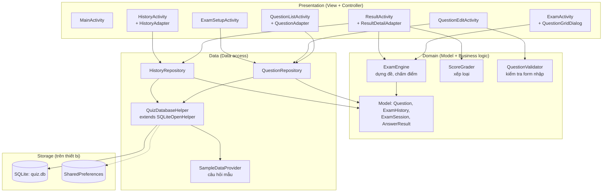


Điều hướng giữa các màn hình:

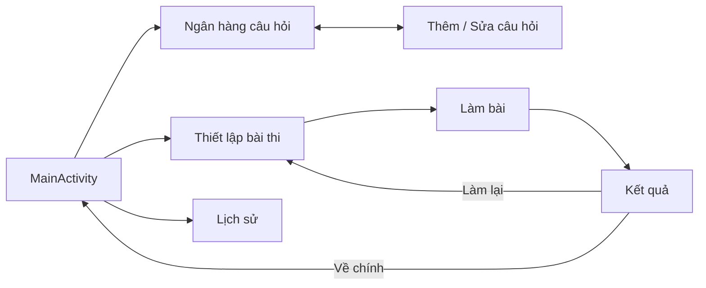


## 2. State Management

**Lựa chọn của nhóm:** không dùng thư viện quản lý state. Nhóm em dùng **biến trạng thái trong Activity + đối tượng `ExamSession` + `onSaveInstanceState` (Bundle)**, còn dữ liệu lâu dài thì để trong **SQLite**.

**Vì sao:**

- Đề bài yêu cầu Java và Android truyền thống (MVC), nên không dùng ViewModel/Compose/Riverpod.
- App chỉ có một chỗ state phức tạp là **phiên thi**, gom hết vào một lớp `ExamSession` nên dễ quản lý.
- Mỗi loại dữ liệu chỉ có **một nơi lưu duy nhất**, tránh việc hai nơi cùng giữ một dữ liệu rồi lệch nhau.
- Nhóm em đã cân nhắc MVVM + LiveData nhưng loại vì thêm nhiều khái niệm so với quy mô app. Nếu mở rộng thì chuyển được vì đã có lớp Repository.

Nhóm em chia state thành 3 loại theo **thời gian hoạt động**:

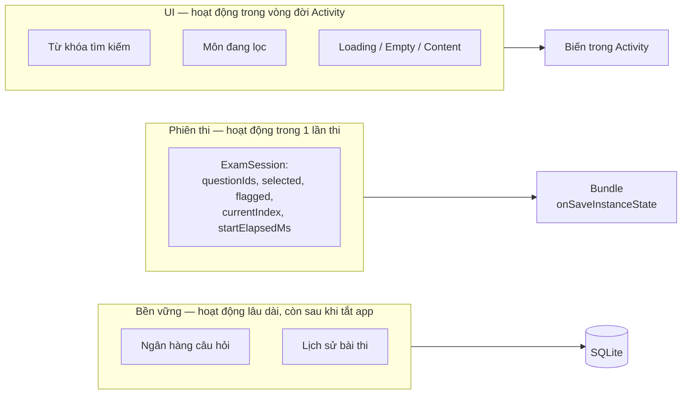

**Trạng thái màn hình danh sách câu hỏi** (mô hình hóa giống `UiState`):

```text
ListState = Loading | Content(danh sách câu hỏi) | Empty(không có dữ liệu / không khớp bộ lọc)
```

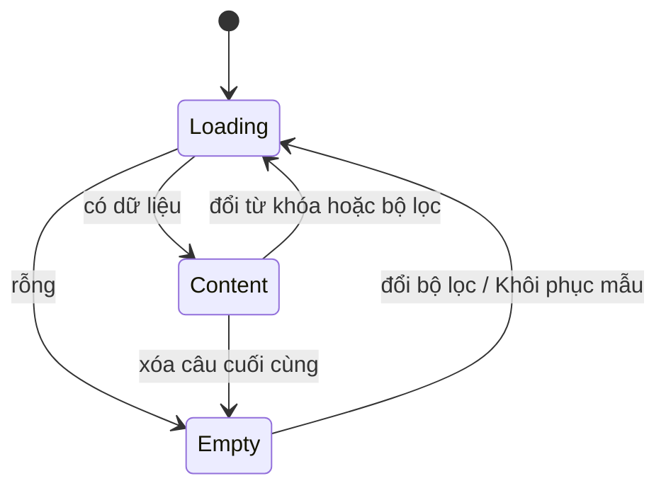

**Trạng thái của một lần thi** (máy trạng thái):

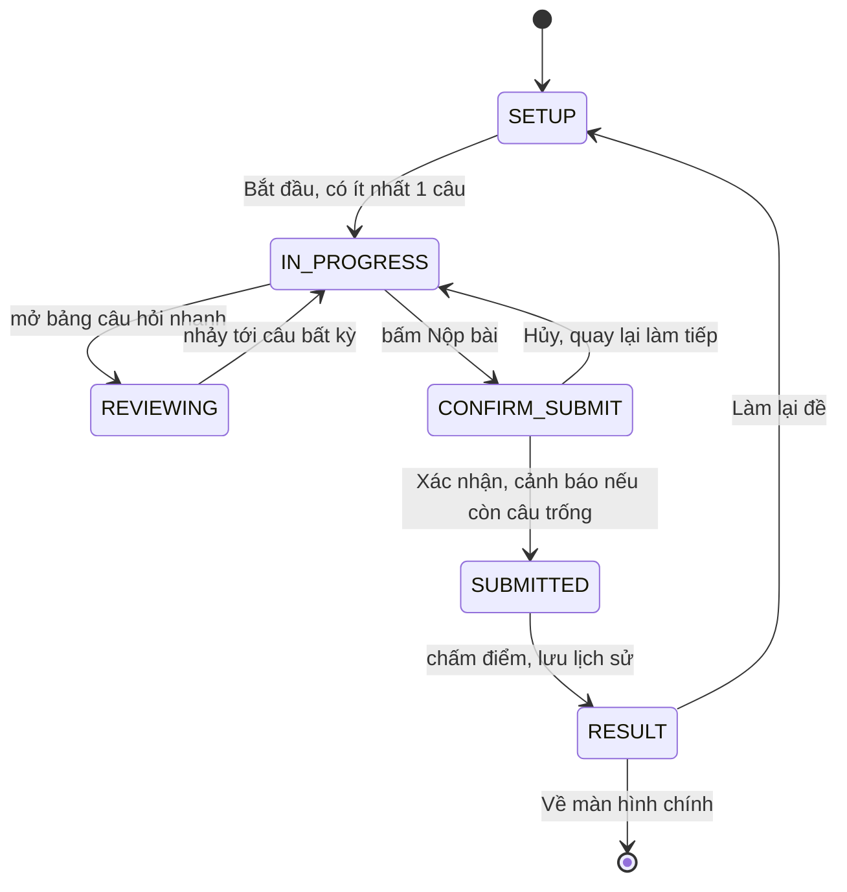

**Xử lý khi xoay màn hình hoặc bị hệ thống thu hồi:**

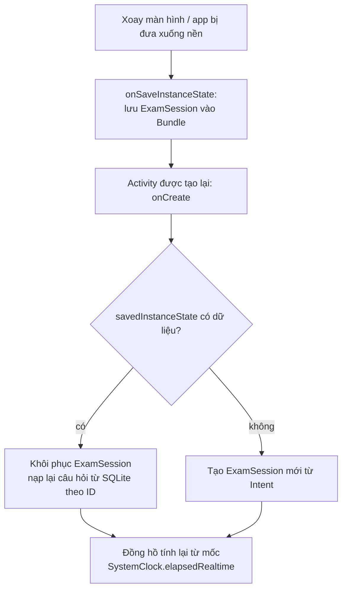

Đồng hồ không cộng dồn từng giây mà lưu **mốc bắt đầu**, mỗi giây lấy `hiện tại − mốc`. Nhờ vậy xoay màn hình hoặc UI bị đứng một chút thì đồng hồ không bị lệch.

---

## 3. Data Flow

Nguyên tắc chung: **sự kiện đi lên (View → Activity → Repository → SQLite), dữ liệu đi xuống (Cursor → Model → Adapter → View)**. Các thao tác DB chạy trên một `ExecutorService` đơn luồng, kết quả đưa về main thread bằng `Handler` để không làm giật giao diện.

### 3.1. Mô hình dữ liệu (ERD)

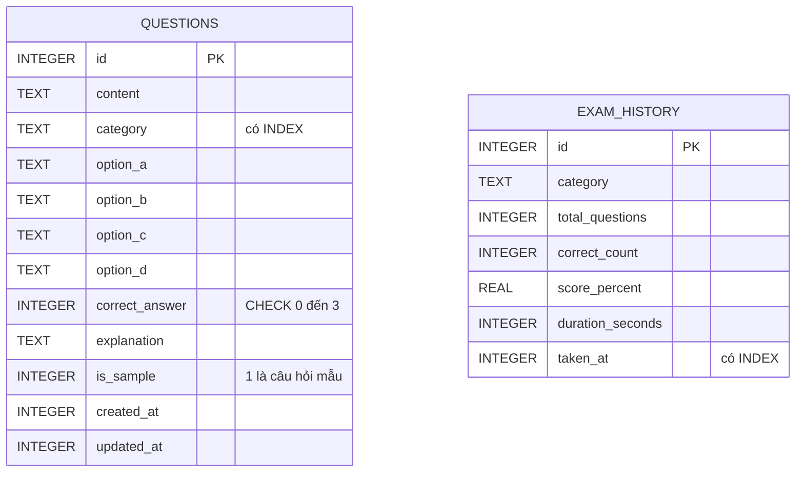

Hai bảng **cố ý không có khóa ngoại**. `exam_history` là bản ghi tổng hợp tại thời điểm thi, nên sửa hay xóa câu hỏi sau này không làm sai hoặc mất lịch sử.

### 3.2. Luồng chính: Thêm câu hỏi mới

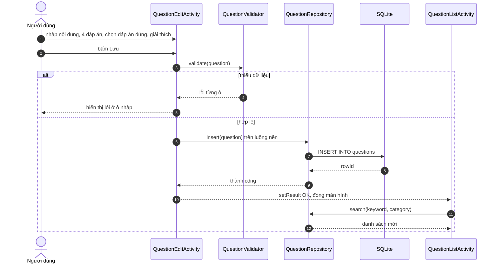

### 3.3. Sửa, xóa, tìm kiếm, lọc

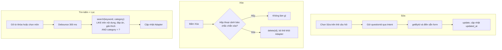

### 3.4. Luồng làm bài thi và kết quả

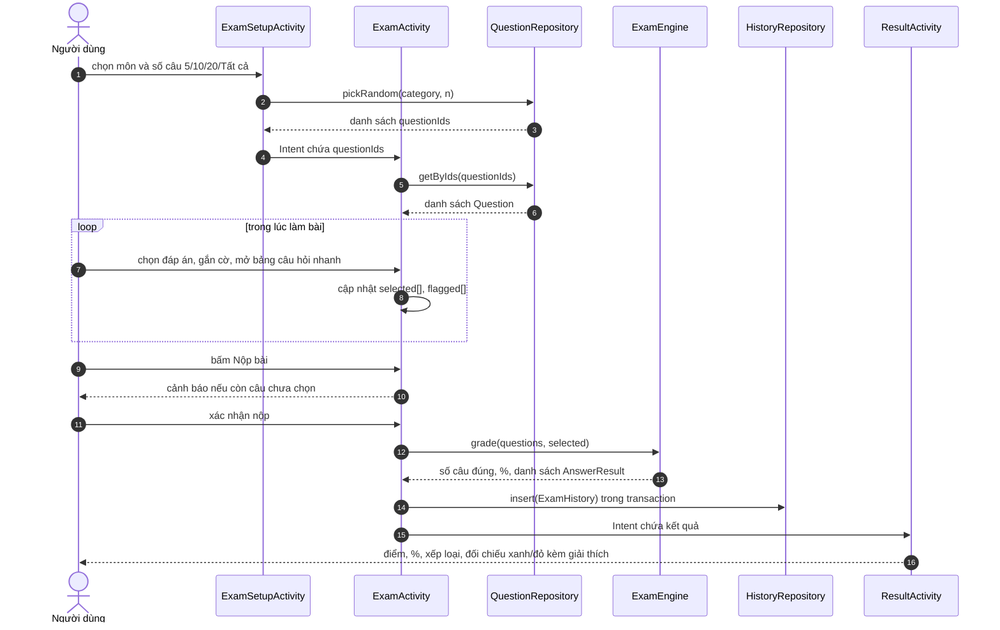

Quy tắc xếp loại do `ScoreGrader` xử lý:

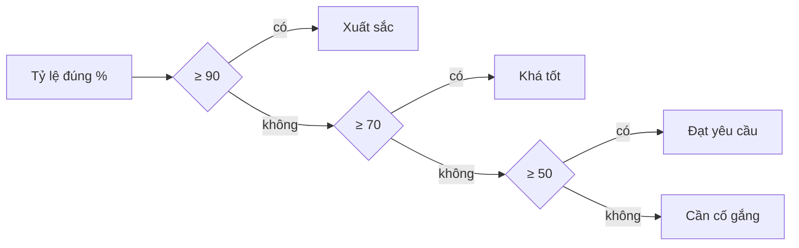

---

## 4. Offline Strategy

App **hoạt động 100% không cần mạng**: không khai báo quyền `INTERNET`, không có server, không đồng bộ. SQLite trên máy là nguồn dữ liệu duy nhất. Vì vậy không có chuyện xung đột dữ liệu giữa nhiều nguồn.

Vì chỉ có một nguồn dữ liệu, chính sách đọc/ghi rất đơn giản:

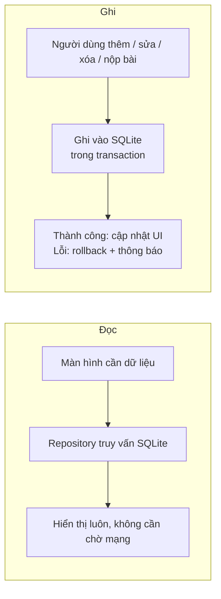

**Lần cài đặt đầu tiên: tự nạp câu hỏi mẫu**

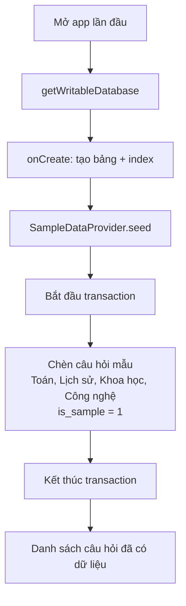

**Khôi phục câu hỏi mẫu** (không làm mất câu hỏi do người dùng tự thêm):

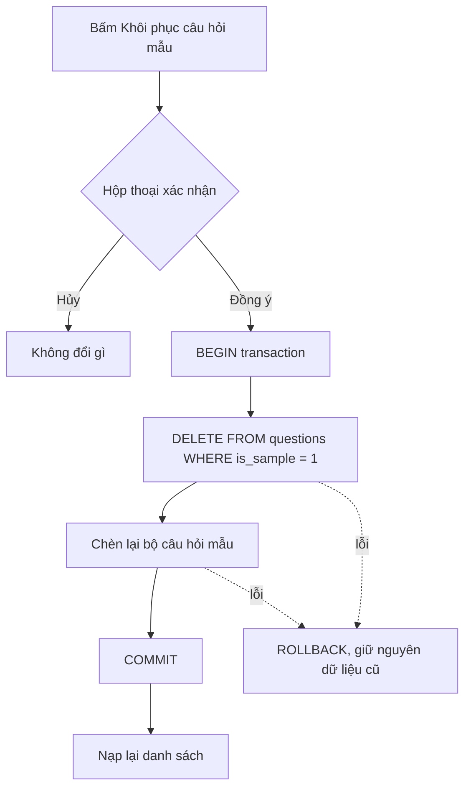

**Nâng cấp phiên bản CSDL:** khi tăng `DATABASE_VERSION`, `onUpgrade()` dùng `ALTER TABLE` từng bước, không `DROP TABLE` dữ liệu người dùng.

**Bảo vệ dữ liệu:**

- File `quiz.db` nằm trong bộ nhớ riêng của app, app khác không đọc được.
- Mọi câu truy vấn dùng tham số `?`, không nối chuỗi, nên chống SQL injection.
- App không lưu dữ liệu nhạy cảm như mật khẩu hay thông tin cá nhân.

## 5. Project Structure

Nhóm em tổ chức theo **từng lớp (package-by-layer)** để khớp với sơ đồ ở mục 1.

```text
app/
├── src/main/
│   ├── AndroidManifest.xml
│   ├── java/com/example/quizapp/
│   │   ├── ui/                         ← Presentation
│   │   │   ├── MainActivity.java
│   │   │   ├── question/
│   │   │   │   ├── QuestionListActivity.java
│   │   │   │   ├── QuestionEditActivity.java
│   │   │   │   └── QuestionAdapter.java
│   │   │   ├── exam/
│   │   │   │   ├── ExamSetupActivity.java
│   │   │   │   ├── ExamActivity.java
│   │   │   │   ├── QuestionGridDialog.java
│   │   │   │   ├── ResultActivity.java
│   │   │   │   └── ResultDetailAdapter.java
│   │   │   └── history/
│   │   │       ├── HistoryActivity.java
│   │   │       └── HistoryAdapter.java
│   │   ├── model/                      ← Domain (đối tượng)
│   │   │   ├── Question.java
│   │   │   ├── ExamHistory.java
│   │   │   ├── ExamSession.java
│   │   │   └── AnswerResult.java
│   │   ├── logic/                      ← Domain (nghiệp vụ)
│   │   │   ├── ExamEngine.java
│   │   │   ├── ScoreGrader.java
│   │   │   └── QuestionValidator.java
│   │   ├── data/                       ← Data
│   │   │   ├── QuizDatabaseHelper.java
│   │   │   ├── DbContract.java         ← tên bảng, tên cột
│   │   │   ├── SampleDataProvider.java
│   │   │   ├── QuestionRepository.java
│   │   │   └── HistoryRepository.java
│   │   └── util/
│   │       ├── AppExecutors.java       ← luồng nền + Handler
│   │       ├── TimeFormatter.java      ← định dạng MM:SS
│   │       └── Constants.java
│   └── res/
│       ├── layout/    activity_*.xml, item_*.xml, dialog_*.xml
│       ├── values/    strings.xml, colors.xml, themes.xml
│       ├── drawable/  nền đáp án đúng / sai / đang chọn
│       └── menu/
└── build.gradle   (Java 11, Material Components, RecyclerView, CardView)
```

Quy ước: Activity/Adapter viết PascalCase, layout dùng `activity_*`/`item_*`/`dialog_*`, ID view có tiền tố loại view (`tvTimer`, `btnSubmit`, `rvQuestions`), bảng và cột SQL dùng snake_case.

---

## 6. Design Decisions

Mỗi quyết định bên dưới gồm **phương án nhóm em chọn** (xanh) và **phương án đã cân nhắc nhưng loại** (xám).

```mermaid
flowchart LR
    D1{{"Kiến trúc"}} ==> C1["MVC: Activity + Adapter + SQLiteOpenHelper<br/>Đúng đề, dễ giải thích"]
    D1 -.-> X1["MVVM + Room<br/>Thêm nhiều khái niệm, vượt quy mô app"]

    D2{{"Lưu trữ"}} ==> C2["SQLite thuần<br/>Tự thiết kế bảng, index, không phụ thuộc thư viện"]
    D2 -.-> X2["Room hoặc file JSON<br/>Room ẩn SQL, JSON khó lọc và tìm kiếm"]

    D3{{"Truy cập dữ liệu"}} ==> C3["Thêm lớp Repository<br/>Gom SQL một chỗ, Activity gọn"]
    D3 -.-> X3["Activity gọi thẳng DatabaseHelper<br/>Code lẫn lộn UI và SQL"]

    D4{{"Đáp án đúng"}} ==> C4["Số 0 đến 3 + CHECK<br/>So sánh nhanh với đáp án đã chọn"]
    D4 -.-> X4["Lưu chữ A/B/C/D<br/>Phải đổi qua lại khi chấm"]

    D5{{"Lịch sử thi"}} ==> C5["Chỉ lưu tổng hợp<br/>Đủ yêu cầu, nhẹ, độc lập với câu hỏi"]
    D5 -.-> X5["Lưu từng câu trả lời<br/>Nặng, phụ thuộc câu hỏi còn tồn tại"]

    D6{{"State phiên thi"}} ==> C6["Lưu ID + mảng trạng thái vào Bundle<br/>Nhẹ, dữ liệu luôn lấy lại từ DB"]
    D6 -.-> X6["Truyền cả danh sách Question<br/>Bundle nặng, dễ lỗi TransactionTooLarge"]

    D7{{"Đồng hồ"}} ==> C7["Mốc elapsedRealtime<br/>Chính xác, không lệch khi xoay màn hình"]
    D7 -.-> X7["CountDownTimer cộng dồn<br/>Dễ lệch khi UI chậm"]

    D8{{"Đa luồng"}} ==> C8["ExecutorService + Handler<br/>Thuần Java, ghi DB tuần tự"]
    D8 -.-> X8["AsyncTask<br/>Đã lỗi thời"]

    D9{{"Câu hỏi mẫu"}} ==> C9["Cột is_sample<br/>Khôi phục mẫu mà không mất câu của người dùng"]
    D9 -.-> X9["Xóa toàn bộ DB rồi nạp lại<br/>Mất dữ liệu người dùng"]

    D10{{"Thao tác nguy hiểm"}} ==> C10["Hộp thoại xác nhận<br/>Xóa, nộp thiếu câu, thoát thi, khôi phục mẫu"]
    D10 -.-> X10["Không xác nhận<br/>Dễ mất dữ liệu do bấm nhầm"]

    classDef chosen fill:#E2EFDA,stroke:#548235,color:#1b3a0a
    classDef rejected fill:#EDEDED,stroke:#999,color:#555
    classDef decision fill:#DEEAF6,stroke:#2E75B6,color:#1F4E79
    class C1,C2,C3,C4,C5,C6,C7,C8,C9,C10 chosen
    class X1,X2,X3,X4,X5,X6,X7,X8,X9,X10 rejected
    class D1,D2,D3,D4,D5,D6,D7,D8,D9,D10 decision
```

**Rủi ro chính và cách nhóm em giảm thiểu:**

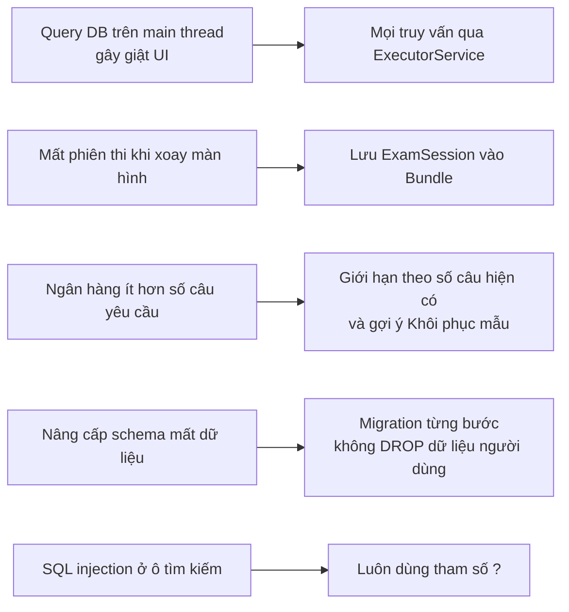

**Hướng mở rộng nếu có thêm thời gian:** chuyển sang MVVM (vẫn giữ nguyên lớp Repository), đổi sang Room, thêm bảng lưu chi tiết từng câu của bài thi cũ, và xuất/nhập câu hỏi bằng JSON hoặc CSV.
