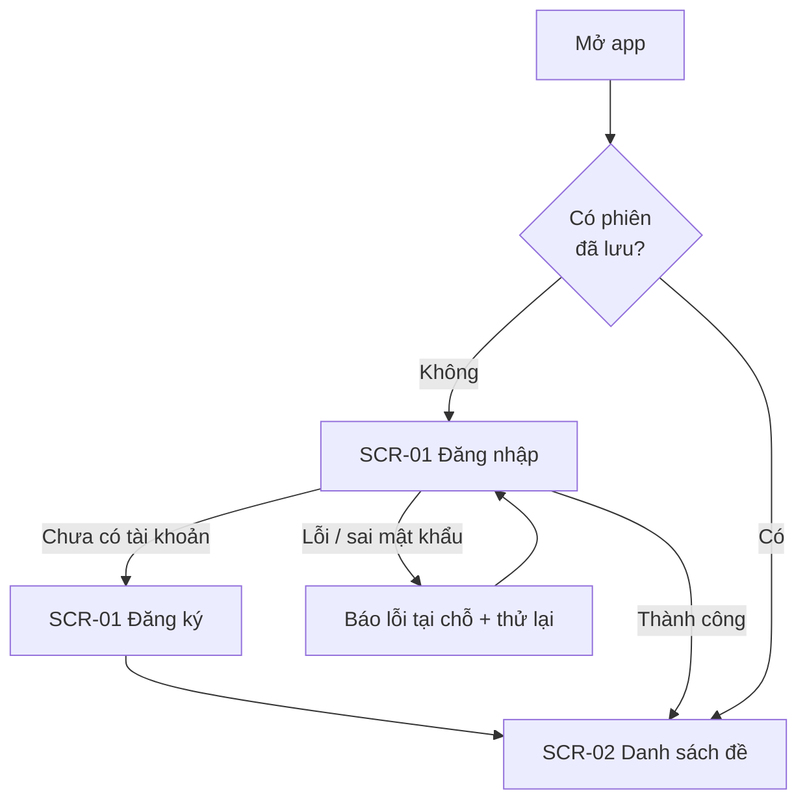
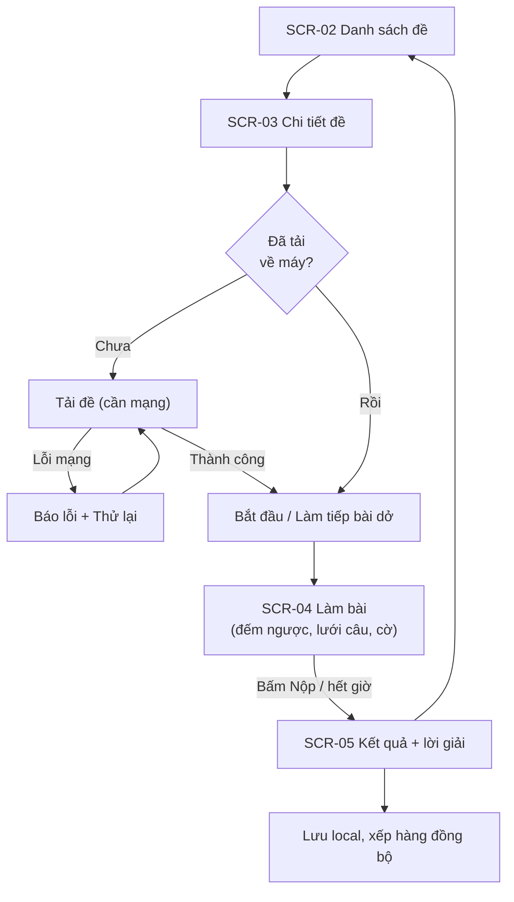
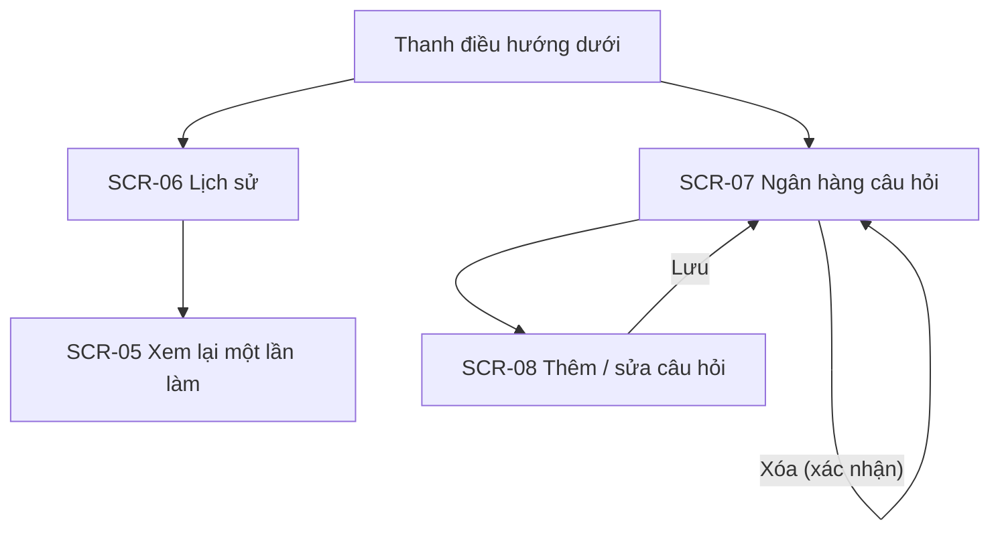

# UI/UX Design

> Complete this document before building screens (Milestone M2) and keep it in sync with the app.
> It is graded under **A2 — UI/UX Design**.

---

## 1. Users & Goals

### 1.1 Product goal

- **Problem solved:** Sinh viên PTIT mất cả tuần để gom đủ câu hỏi và xác minh đáp án cho một bộ 100–200 câu trắc nghiệm, trong khi ôn xong chỉ cần vài giờ; các website thi thử lại bị gián đoạn và mất bài khi rớt mạng.
- **Value delivered:** Chọn đề, tải về và bắt đầu làm bài trong tối đa 3 lần chạm; làm bài hoàn toàn offline, không mất đáp án khi xoay màn hình hoặc bị hệ điều hành tắt ngầm; chấm điểm ngay kèm lời giải thích từng câu.

### 1.2 Personas

*(Persona dựng từ giả định của nhóm về người dùng mục tiêu; nên kiểm chứng bằng khảo sát nhanh với bạn bè.)*

| | Persona 1 | Persona 2 |
|---|---|---|
| **Who** | Hiệp, sinh viên năm 2 ở ký túc xá, có 3–4 môn thi trắc nghiệm trong một đợt thi | Nghĩa, sinh viên năm 3, đi học bằng xe buýt, vừa học vừa đi làm thêm |
| **Context of use** | Buổi tối ở ký túc xá, Wi-Fi chập chờn; Android tầm trung, màn hình 6 inch; phiên ôn 30–45 phút | Trên xe buýt 20–30 phút mỗi chiều, 4G yếu và hay mất sóng; dùng một tay |
| **Needs / pain points** | Cần có sẵn bộ đề đã kiểm chứng đáp án để không phải tự gom; muốn biết mình sai ở đâu; sợ mất bài làm dở khi rớt mạng | Cần tải đề trước khi lên xe; cần nút to dễ chạm bằng một tay; muốn làm dở rồi quay lại làm tiếp mà không mất tiến độ |

---

## 2. User Flows

### 2.1 Đăng nhập / đăng ký

Người dùng chưa đăng nhập chỉ thấy màn hình đăng nhập/đăng ký; sau khi đăng nhập, phiên được lưu an toàn nên lần mở sau vào thẳng danh sách đề.

### 2.2 Tải đề và làm bài (luồng chính)

### 2.3 Lịch sử và ngân hàng câu hỏi

---

## 3. Screen Inventory

| ID | Screen | Purpose | Main components | Data source |
|:--:|--------|---------|-----------------|-------------|
| `SCR-01` | Đăng nhập / Đăng ký | Xác thực người dùng | Ô email, mật khẩu, nút chính, chuyển đổi đăng nhập/đăng ký, thông báo lỗi | API `/users`, `/login` (mock); phiên lưu local an toàn |
| `SCR-02` | Danh sách đề | Duyệt đề theo môn | Thẻ "Tiếp tục làm bài" (khi có bài làm dở), biểu tượng tìm kiếm, chip lọc môn, thẻ đề (số câu, thời lượng, nhãn "Đã tải"), pull-to-refresh | API `/exams`, `/subjects` + cache Room |
| `SCR-03` | Chi tiết đề | Xem thông tin đề và tải về | Tên, môn, số câu, thời lượng, nút Tải về / Bắt đầu / Làm tiếp, tiến trình tải | API `/exams/{id}`, `/questions?examId=` → lưu Room |
| `SCR-04` | Làm bài thi | Làm bài có tính giờ | Đồng hồ đếm ngược, thanh tiến độ, câu hỏi + 4 đáp án, cờ, lưới câu, nút Trước/Sau/Nộp | Room (đề đã tải + bài đang làm) |
| `SCR-05` | Kết quả và lời giải | Xem điểm, đáp án đúng/sai, giải thích | Điểm, thời gian, danh sách câu đúng/sai, lời giải, nhãn đồng bộ | Room (`Attempt`) |
| `SCR-06` | Lịch sử bài thi | Xem các lần đã làm | Danh sách lần làm (điểm, ngày), nhãn Chờ đồng bộ / Đã đồng bộ / Lỗi | Room + API `/attempts` |
| `SCR-07` | Ngân hàng câu hỏi | Quản lý câu hỏi | Danh sách câu, tìm kiếm, nút thêm, vuốt/menu sửa-xóa | API `/questions` + cache Room |
| `SCR-08` | Form thêm / sửa câu hỏi | Tạo hoặc sửa một câu | Nội dung, 4 đáp án, chọn đáp án đúng, lời giải, nút Lưu | API `/questions` (POST/PUT) |

Hộp thoại **Xác nhận xóa** (hỏi lại trước khi xóa một câu hỏi) là một phần của `SCR-07`, không tính là màn hình riêng.

Điều hướng chính: thanh dưới gồm **Đề thi** (SCR-02), **Lịch sử** (SCR-06), **Câu hỏi** (SCR-07); đăng xuất nằm trong menu `⋮` ở thanh trên.

---

## 4. Wireframes

Wireframe cho toàn bộ 8 màn hình, thiết kế theo phong cách giao diện PTIT S-Link để người dùng là sinh viên PTIT thấy quen thuộc: thanh đầu màu đỏ, thẻ nổi bo tròn, thẻ sự kiện nền xanh nhạt có thanh màu bên trái, nút bo tròn, thanh điều hướng dưới với mục đang chọn màu đỏ. Mũi tên giữa các màn hình thể hiện luồng chuyển màn. Tên, điểm và ngày trong hình chỉ là dữ liệu minh họa. Ảnh nằm trong `docs/asset/wireframes/`, bản vector chỉnh sửa được nằm trong `docs/asset/wireframes/svg/`.

- Link file thiết kế: *(điền link Canva/Figma nếu nhóm import lại để chỉnh sửa)*

**Sơ đồ 1 — Đăng nhập → danh sách đề → chi tiết đề** (`SCR-01`, `SCR-02`, `SCR-03`)

**Sơ đồ 2 — Làm bài → kết quả** (`SCR-04` kèm lưới câu hỏi, `SCR-05`)

**Sơ đồ 3 — Lịch sử và ngân hàng câu hỏi** (`SCR-06`, `SCR-07`, hộp thoại xác nhận xóa, `SCR-08`)

**Sơ đồ 4 — Các trạng thái UI của `SCR-02`** (Loading, Success, Empty, Error + Retry, Offline dùng cache)

---

## 5. Design Tokens

### 5.1 Colors

| Token | Light | Dark | Usage |
|-------|-------|------|-------|
| `primary` | | | |
| `secondary` | | | |
| `background` | | | |
| `surface` | | | |
| `text-primary` | | | |
| `error` | | | |
| `success` | | | |

### 5.2 Typography & spacing

| Token | Value | Usage |
|-------|-------|-------|
| `title` | *(e.g., 22sp semibold)* | |
| `body` | | |
| `caption` | | |
| `spacing-unit` | *(e.g., 8dp)* | |

---

## 6. UI States

For every screen that loads data, design all four states:

| Screen | Loading | Success | Empty | Error (with retry) |
|--------|---------|---------|-------|--------------------|
| *(SCR-0x)* | *(skeleton / spinner)* | | *(message + call to action)* | *(friendly message + Retry)* |

---

## 7. Accessibility & Adaptivity

- Minimum touch target, contrast, dynamic font size:
- Small screens, tablets, rotation:
- Dark mode:

---

## 8. Design Decisions

| Decision | Alternatives considered | Why we chose this |
|----------|------------------------|-------------------|
| | | |
